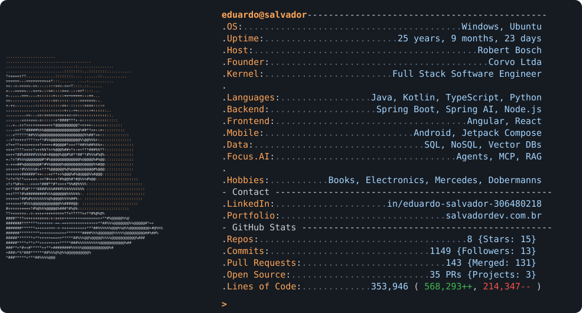

  <a href="https://salvadordev.com.br"><picture><source media="(prefers-color-scheme: dark)" srcset="link_portfolio_dark.svg"></picture></a>
  <a href="https://www.linkedin.com/in/eduardo-salvador-306480218/"><picture><source media="(prefers-color-scheme: dark)" srcset="link_linkedin_dark.svg"></picture></a>

  <a href="https://salvadordev.com.br">
    <picture>
      <source media="(prefers-color-scheme: dark)" srcset="dark_mode.svg">
      
    </picture>
  </a>

  

  
  
  
  
  

  <picture>
    <source media="(prefers-color-scheme: dark)" srcset="pacman_dark.svg">
    
  </picture>

